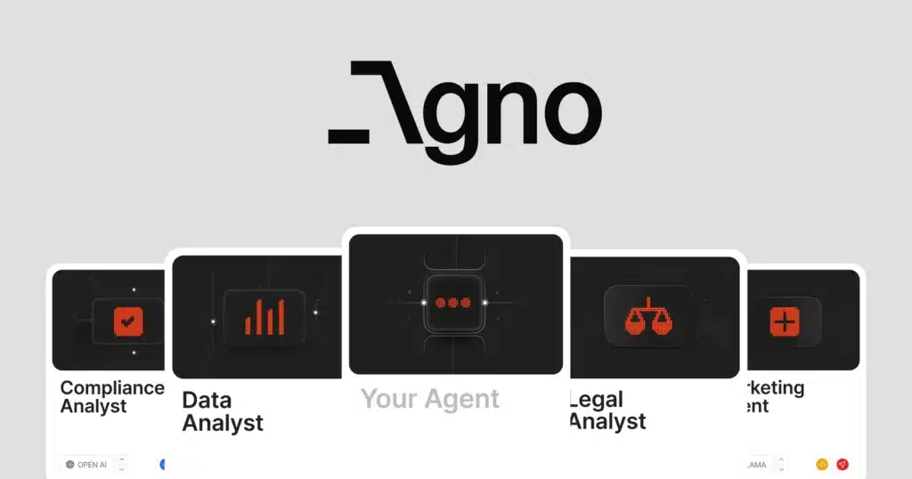

# Agno Framework Crash Course

<p align="center">
  <a href="https://github.com/Md-Emon-Hasan/Agno-Framework-Crash-Course"></a>
  
  <a href="https://ai.google.dev/"></a>
  <a href="https://groq.com/"></a>
  <a href="https://streamlit.io/"></a>
  <a href="../LICENSE"></a>
</p>

<p align="center">
  <a href="https://github.com/agno-agi/agno"></a>
  
  
  
</p>

<p align="center">
  
</p>

**A hands-on collection of Python examples for building AI agents and multi-agent applications with [Agno](https://www.agno.com/).**

The course moves from a single tool-using assistant to agent teams, financial research interfaces, and video analysis. Examples use Gemini and Groq models, web search, market data, Streamlit, and Agno's AgentOS.

## Contents

- [Examples](#examples)
- [Technology](#technology)
- [Requirements](#requirements)
- [Quick start](#quick-start)
- [Configure API keys](#configure-api-keys)
- [Run an example](#run-an-example)
- [How the video example works](#how-the-video-example-works)
- [Project layout](#project-layout)
- [Security and usage notes](#security-and-usage-notes)
- [Troubleshooting](#troubleshooting)
- [Contributing](#contributing)
- [License](#license)
- [Connect with me](#connect-with-me)

## Examples

| Lesson | Example | What it demonstrates | Run from the repository root |
| --- | --- | --- | --- |
| 1. Basic agents | `simpleagent.py` | A Gemini assistant with DuckDuckGo search | `python "1 - BasicAgents/simpleagent.py"` |
| 1. Basic agents | `multiagents.py` | A web researcher and finance analyst collaborating as an Agno team | `python "1 - BasicAgents/multiagents.py"` |
| 1. Basic agents | `multiagents_app.py` | A Streamlit interface for the research team | `streamlit run "1 - BasicAgents/multiagents_app.py"` |
| 2. Financial AI analyst | `financial_agent.py` | Financial research that combines web search and Yahoo Finance data | `python "2 - Financial AI Analyst/financial_agent.py"` |
| 2. Financial AI analyst | `playground.py` | Serves the finance and web agents through Agno AgentOS | `python "2 - Financial AI Analyst/playground.py"` |
| 3. Video summarizer | `app.py` | A Streamlit app that sends an uploaded video to Gemini for analysis | `streamlit run "3 - Video Summarizer Agentic AI/app.py"` |

The finance examples provide informational research, not investment advice. Market data and news may be delayed or incomplete.

## Technology

<p>
  
  
  
  
  
  
  
  
</p>

The examples use the Agno Python SDK, Gemini and Groq model providers, DuckDuckGo search tools, `yfinance` tools, Streamlit, and AgentOS. `python-dotenv` loads local development settings from `.env`.

## Requirements

- Python 3.10 or newer
- A Google AI Studio API key for Gemini examples
- A Groq API key only if you choose a Groq model
- Internet access for model requests, web search, and market data

API keys are not included. Create your own keys with the providers and keep them private.

## Quick start

Clone the repository and move into its directory:

```bash
git clone https://github.com/Md-Emon-Hasan/Agno-Framework-Crash-Course.git
cd Agno-Framework-Crash-Course
```

Create and activate a virtual environment:

```bash
python -m venv .venv
```

Windows PowerShell:

```powershell
.venv\Scripts\Activate.ps1
```

macOS or Linux:

```bash
source .venv/bin/activate
```

Install the project dependencies:

```bash
python -m pip install --upgrade pip
pip install -r requirements.txt
```

Create a local `.env` file in this directory and add only the provider keys you need. Set at least `GOOGLE_API_KEY` to run the Gemini examples; Groq is optional. See [Configure API keys](#configure-api-keys).

## Configure API keys

The Python examples load variables from a `.env` file in this course folder. Create the file locally and add the keys you need:

```dotenv
GOOGLE_API_KEY=your_google_ai_studio_key
GROQ_API_KEY=your_groq_api_key
GEMINI_MODEL=gemini-3.7-flash
GROQ_MODEL=llama-3.3-70b-versatile
```

`GOOGLE_API_KEY` is required for Gemini. Set `GROQ_API_KEY` only when using Groq. The model names can be changed in `.env` to models available to your provider account. Do not commit `.env` or paste API keys into source files.

## Run an example

Run commands from the repository root so `.env` is found. Start with the single-agent example:

```bash
python "1 - BasicAgents/simpleagent.py"
```

Start the multi-agent Streamlit interface:

```bash
streamlit run "1 - BasicAgents/multiagents_app.py"
```

Open the local URL printed by Streamlit. To launch the financial research service with Agno AgentOS:

```bash
python "2 - Financial AI Analyst/playground.py"
```

AgentOS starts locally at `http://localhost:7777`. The API serves the registered agents; it is not the legacy Agno Playground UI.

## How the video example works

Launch the Streamlit app:

```bash
streamlit run "3 - Video Summarizer Agentic AI/app.py"
```

Upload a supported video file, enter a question about its contents, and select **Analyze video**. The app passes the uploaded file to the Gemini model as video input and displays the response. Video model support, file limits, and processing time depend on the model and Google account. The uploaded file is written to a temporary local file while it is analyzed and removed afterward.

## Project layout

```text
.
├── 1 - BasicAgents/
│   ├── simpleagent.py          # Single tool-using assistant
│   ├── multiagents.py          # Command-line agent team
│   └── multiagents_app.py      # Streamlit agent-team interface
├── 2 - Financial AI Analyst/
│   ├── financial_agent.py      # Financial research example
│   └── playground.py           # AgentOS API service
├── 3 - Video Summarizer Agentic AI/
│   └── app.py                  # Video analysis interface
├── banner.png                  # Repository banner
├── requirements.txt            # Python dependencies
└── README.md
```

## Security and usage notes

- Keep `.env` private. This course folder's `.gitignore` excludes local environment files.
- Model and search calls require internet access and may incur provider charges or usage limits.
- Do not upload confidential or sensitive videos to a hosted model unless you have permission and have reviewed the provider's data policies.
- Financial outputs can be wrong or out of date. Verify information independently before making financial decisions.

## Troubleshooting

| Problem | What to check |
| --- | --- |
| Missing Google API key | Add `GOOGLE_API_KEY` to the root `.env` file and restart the command. |
| Authentication or model error | Check that the provider key is valid and the configured model is enabled for your account. |
| Search or finance tool fails | Check your internet connection and retry; third-party services can rate-limit or change availability. |
| `ModuleNotFoundError` | Activate the virtual environment and run `pip install -r requirements.txt` again. |
| Streamlit command not found | Activate the virtual environment, then use `python -m streamlit run "path/to/app.py"`. |
| Video analysis fails | Try a smaller supported video and confirm that the configured Gemini model accepts video input. |
| AgentOS port is busy | Stop the other process on port 7777 or set `AGENT_OS_PORT` to another local port. |

## Contributing

Contributions that improve the examples, setup, or documentation are welcome:

1. Fork the repository and create a feature branch.
2. Make a focused change and describe it in your pull request.
3. Keep secrets, virtual environments, and generated files out of commits.

## License

This course is part of the repository distributed under the [Apache License 2.0](../LICENSE).

## Connect with me

- **Portfolio:** [emonlabs-ai.hitechparks.com](https://emonlabs-ai.hitechparks.com)
- **GitHub:** [Md-Emon-Hasan](https://github.com/Md-Emon-Hasan)
- **LinkedIn:** [Md Emon Hasan](https://www.linkedin.com/in/md-emon-hasan-695483237/)
- **Hugging Face:** [emonHasan01](https://huggingface.co/emonHasan01)
- **Email:** [emon.mlengineer@gmail.com](mailto:emon.mlengineer@gmail.com)
- **WhatsApp:** [+8801834363533](https://wa.me/8801834363533)
