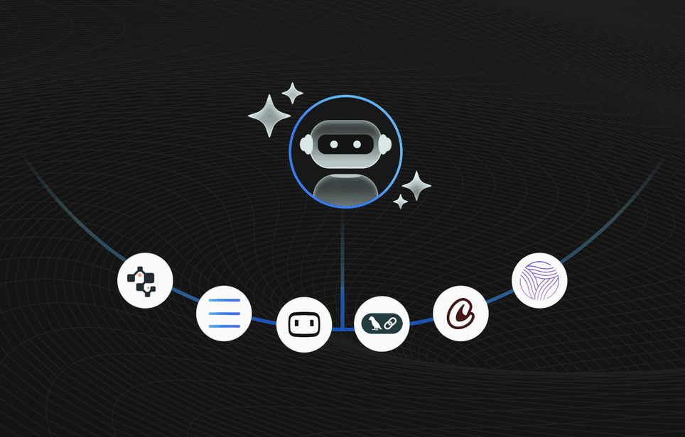

# CrewAI Framework Crash Course

[](https://www.python.org/)
[](https://www.crewai.com/)
[](https://jupyter.org/)
[](../LICENSE)

<p align="center"></p>

A set of introductory CrewAI notebooks and scripts for learning how agents, tasks, tools, crews, and YAML configuration fit together. The examples include email-focused agents, tool use, crew workflows, and memory.

## Lessons

| File | What it covers |
| --- | --- |
| `1_email_agent.ipynb` | A basic email-focused agent. |
| `2_email_agent_with_tool.ipynb` | Extending an agent with a tool. |
| `3_crew.ipynb` | Defining agents and tasks as a crew. |
| `4_crew_with_tools.ipynb` | Crew workflows that use tools. |
| `5_yaml.py` | A blog research and writing crew configured with YAML files. |
| `6_memory.ipynb` | Memory concepts in a CrewAI example. |

The YAML-based example reads `config/agents.yaml` and `config/tasks.yaml`. It uses a Serper search tool, so it requires a Serper API key in addition to the configured model-provider credentials.

## Requirements

- Python 3.10 or newer is recommended.
- Jupyter Notebook or JupyterLab for `.ipynb` lessons.
- CrewAI and any tool integrations imported by the lesson you choose.
- Provider credentials for model or search services used by that lesson.

This course does not currently include a `requirements.txt`. Install dependencies for the selected lesson in a virtual environment, and consult that notebook's imports and CrewAI documentation if a package is missing. CrewAI integrations change over time, so use mutually compatible package versions.

## Setup

From this directory, create and activate an isolated environment:

```powershell
py -m venv .venv
.venv\Scripts\Activate.ps1
python -m pip install --upgrade pip
pip install crewai crewai-tools jupyter python-dotenv
```

On macOS or Linux, activate it with `source .venv/bin/activate`.

Set the provider keys required by your selected lesson in the environment or a local `.env` file. For example, the YAML lesson uses a model configured in `config/agents.yaml` and `SerperDevTool`; check the model provider and CrewAI tool documentation for the corresponding variable names. Never commit real credentials.

## Run a lesson

Start Jupyter from this folder:

```bash
jupyter notebook
```

Open a lesson notebook and run its cells in order. To run the YAML example from this directory:

```bash
python 5_yaml.py
```

Some lessons call hosted models or external tools and need internet access. Provider access, quotas, and charges depend on your account.

## Project layout

```text
.
├── README.md
├── 1_email_agent.ipynb
├── 2_email_agent_with_tool.ipynb
├── 3_crew.ipynb
├── 4_crew_with_tools.ipynb
├── 5_yaml.py
├── 6_memory.ipynb
└── config/
    ├── agents.yaml
    └── tasks.yaml
```

## License

This course is part of the repository distributed under the [Apache License 2.0](../LICENSE).

## Connect with me

- **Portfolio:** [emonlabs-ai.hitechparks.com](https://emonlabs-ai.hitechparks.com)
- **GitHub:** [Md-Emon-Hasan](https://github.com/Md-Emon-Hasan)
- **LinkedIn:** [Md Emon Hasan](https://www.linkedin.com/in/md-emon-hasan-695483237/)
- **Hugging Face:** [emonHasan01](https://huggingface.co/emonHasan01)
- **Email:** [emon.mlengineer@gmail.com](mailto:emon.mlengineer@gmail.com)
- **WhatsApp:** [+880 1834-363533](https://wa.me/8801834363533)
