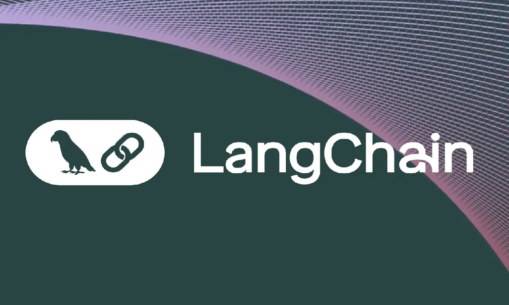

# LangChain: Basic to Advanced


[](../LICENSE)



A hands-on notebook for learning LangChain concepts and building language-model applications with Hugging Face. The examples progress from basic model calls and reusable prompts to chains, agents, conversational memory, document loading, dataframe tools, and local model pipelines.

## Contents

- [Project overview](#project-overview)
- [What you will learn](#what-you-will-learn)
- [Repository structure](#repository-structure)
- [Getting started](#getting-started)
- [Hugging Face authentication](#hugging-face-authentication)
- [Running the notebook](#running-the-notebook)
- [Hardware and model notes](#hardware-and-model-notes)
- [Troubleshooting](#troubleshooting)
- [Contributing](#contributing)
- [Contact](#contact)
- [License](#license)

## Project overview

This repository is organized around one end-to-end Jupyter notebook. It uses LangChain with Hugging Face models to demonstrate foundational and intermediate building blocks for LLM applications. Run the notebook from top to bottom: later examples reuse objects and imports created in earlier cells.

The notebook is educational material. Model access, package compatibility, hardware needs, and generated results depend on your environment and the model provider.

## What you will learn

The notebook includes examples of:

- Initializing Hugging Face language models and sending basic prompts.
- Creating prompt templates and composing LLM chains.
- Building simple sequential and multi-step sequential chains.
- Connecting agents to tools, including a Wikipedia query tool.
- Keeping conversation context with buffer memory and conversation chains.
- Loading PDF documents with LangChain document loaders.
- Using an agent to work with pandas DataFrames.
- Calling hosted Hugging Face models through the Hub API.
- Loading open-source models locally with Transformers pipelines and PyTorch.

## Repository structure

```text
.
├── banner.png
├── LangChain_Complete_Notebook.ipynb
└── README.md
```

## Getting started

### Requirements

- Python 3.9 or later is recommended.
- Jupyter Notebook, JupyterLab, or Google Colab.
- A Hugging Face account and access token for examples that call hosted models.
- PyTorch and enough memory for any local model you choose to load. A GPU is optional for hosted-model examples and helpful for larger local models.

### Install dependencies

Create and activate a virtual environment, then install the packages used by the notebook:

```bash
python -m venv .venv
```

On Windows PowerShell:

```powershell
.venv\Scripts\Activate.ps1
```

On macOS or Linux:

```bash
source .venv/bin/activate
```

Install the notebook dependencies:

```bash
python -m pip install --upgrade pip
python -m pip install langchain langchain-community langchain-experimental huggingface-hub transformers pandas pypdf wikipedia
```

Install PyTorch using the command recommended for your operating system and hardware at [pytorch.org](https://pytorch.org/get-started/locally/). GPU-enabled installations depend on your CUDA setup; CPU-only usage is also possible for models that fit in memory.

The notebook uses LangChain's classic chain, agent, memory, and Hugging Face integration APIs. LangChain changes quickly, so an API change or package incompatibility may require adapting an example or using package versions compatible with those APIs.

## Hugging Face authentication

Some hosted-model examples require a Hugging Face access token. Create one in your [Hugging Face account settings](https://huggingface.co/settings/tokens), then make it available as the `HUGGINGFACEHUB_API_TOKEN` environment variable before running those cells.

PowerShell for the current terminal session:

```powershell
$env:HUGGINGFACEHUB_API_TOKEN = "your-token"
```

macOS or Linux for the current terminal session:

```bash
export HUGGINGFACEHUB_API_TOKEN="your-token"
```

If you use Google Colab, store the token in Colab Secrets and read it from there. Never commit a real token, password, or other secret to the notebook or repository. The notebook includes token setup cells; replace blank or placeholder values locally, or adapt those cells to read the environment variable.

## Running the notebook

1. Clone or download this repository.
2. Install the dependencies and configure a token if you plan to use hosted models.
3. Start Jupyter from the repository folder:

   ```bash
   jupyter notebook
   ```

4. Open [`LangChain_Complete_Notebook.ipynb`](LangChain_Complete_Notebook.ipynb) and run cells in order.
5. Skip hosted-model or local-model sections you do not need. Local model downloads can be large and may require substantial RAM or GPU memory.

You can also open the notebook in Google Colab:

[](https://colab.research.google.com/github/Md-Emon-Hasan/LangChain-Framework-Basic-to-Advanced/blob/master/LangChain_Complete_Notebook.ipynb)

## Hardware and model notes

- Hosted inference needs an internet connection, a valid Hugging Face token, and model access granted by the provider where applicable.
- Local inference downloads model weights to your machine. Choose a model that fits your available memory; GPU acceleration is optional and depends on a compatible PyTorch setup.
- The notebook uses the `google/flan-t5-large` Hub model in an example. Provider availability and access requirements can change.
- Notebook examples may incur provider charges depending on the model and account plan. Review provider terms before use.

## Troubleshooting

**Authentication or access errors:** Check that `HUGGINGFACEHUB_API_TOKEN` is set in the same environment that launches Jupyter, and confirm your account can access the selected model.

**Import errors or changed LangChain APIs:** Install the missing package, restart the notebook kernel, and review the current LangChain and integration-package documentation. Older notebook APIs may need code changes when used with newer package releases.

**Out-of-memory errors:** Skip local-model cells, select a smaller model, use a hosted model, or run on hardware with more available memory.

**A cell fails after an earlier edit:** Restart the kernel and run the notebook from the first cell so that variables and imports are initialized in order.

## Contributing

Suggestions, corrections, and improvements are welcome. Please open an issue to describe a bug or proposed change, or submit a pull request with a clear summary. Keep examples reproducible, avoid committing credentials or private data, and update this README when the project structure or notebook topics change.

## Contact

**Md Emon Hasan**

- Portfolio: [emonlabs-ai.hitechparks.com](https://emonlabs-ai.hitechparks.com)
- GitHub: [Md-Emon-Hasan](https://github.com/Md-Emon-Hasan)
- LinkedIn: [Md Emon Hasan](https://www.linkedin.com/in/md-emon-hasan-695483237/)
- Hugging Face: [emonHasan01](https://huggingface.co/emonHasan01)
- Email: [emon.mlengineer@gmail.com](mailto:emon.mlengineer@gmail.com)
- WhatsApp: [+880 1834-363533](https://wa.me/8801834363533)

## License

This course is part of the repository distributed under the [Apache License 2.0](../LICENSE).
