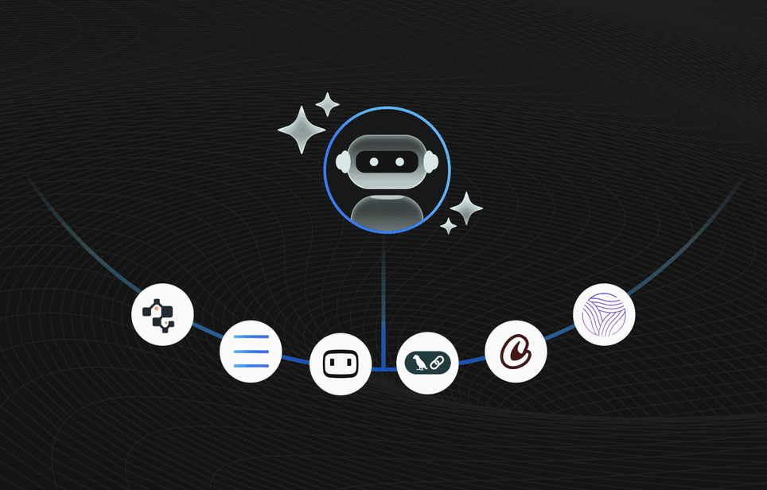

# Generative AI Frameworks: LangChain, LangGraph, LangSmith, CrewAI & Agno

<p align="center">
  <a href="https://www.python.org/"></a>
  <a href="https://www.langchain.com/"></a>
  <a href="https://www.langchain.com/langgraph"></a>
  <a href="https://www.langchain.com/langsmith"></a>
  <a href="https://www.crewai.com/"></a>
  <a href="https://www.agno.com/"></a>
  <a href="https://jupyter.org/"></a>
  <a href="LICENSE"></a>
</p>

<p align="center">
  
</p>

**A practical learning repository for building LLM applications, stateful workflows, and AI agents with five widely used Python frameworks.** It brings together course material, notebooks, and runnable examples for LangChain, LangGraph, LangSmith, CrewAI, and Agno.

> These examples are for learning and may need small changes as framework APIs and model-provider services evolve. Review each course's setup instructions before running its examples.

## Contents

- [Repository overview](#repository-overview)
- [Courses and learning paths](#courses-and-learning-paths)
- [Technology](#technology)
- [Requirements](#requirements)
- [Getting started](#getting-started)
- [Configure provider credentials](#configure-provider-credentials)
- [Choose a course](#choose-a-course)
- [Repository structure](#repository-structure)
- [Security and usage notes](#security-and-usage-notes)
- [Contributing](#contributing)
- [License](#license)
- [Connect with me](#connect-with-me)

## Repository overview

This repository is a collection of independent learning tracks, not one installable application. Each framework has its own folder, examples, dependencies, and setup requirements. You can follow one course without installing the packages for the others.

The material includes Jupyter notebooks and Python scripts. Depending on the course, examples cover prompt and chain composition, retrieval-augmented generation (RAG), graph-based orchestration, tracing and evaluation, tool use, agent teams, memory, and small interactive applications.

## Courses and learning paths

| Course | Start here | Format | Topics and examples |
| --- | --- | --- | --- |
| **LangChain: Basic to Advanced** | [Course README](LangChain-Framework-Basic-to-Advanced/README.md) | Complete Jupyter notebook | Prompts, chains, agents, memory, document loading, DataFrame tools, Hugging Face models, and Transformers pipelines. |
| **LangGraph: From Basics to Advanced** | [Course README](LangGraph-Framework-Basic-to-Advanced/README.md) | 12 numbered topic folders with notebooks | Graph state and routing, memory, tools, planner/executor flows, reliability patterns, multi-agent workflows, human review, schemas, and Chroma RAG. |
| **LangSmith Crash Course** | [Course README](LangSmith-Framework-Crash-Course/README.md) | Five Python examples; RAG uses a local PDF you supply | LLM calls, sequential chains, PDF RAG with FAISS, a tool-using agent, and LangGraph tracing. LangSmith provides tracing and observability for the examples; workflow orchestration comes from LangChain or LangGraph. |
| **CrewAI Framework Crash Course** | [Course README](CrewAI-Framework-Crash-Course/README.md) | Jupyter notebooks, Python, YAML configuration | Email agents, tools, crews, YAML-defined agents and tasks, and memory examples. |
| **Agno Framework Crash Course** | [Course README](Agno-Framework-Crash-Course/README.md) | Python examples and Streamlit apps | Single and multi-agent examples, web research, financial data, video summarization, and Agno AgentOS. |

Start with the course README for its current dependencies, credentials, and run commands. Some examples call external model or search APIs and require provider keys; foundational notebooks may not.

## Technology

The project uses **Python** throughout. Depending on the course, its code and notebooks also use **Jupyter**, **LangChain**, **LangGraph**, **LangSmith**, **CrewAI**, **Agno**, **Hugging Face Transformers**, **PyTorch**, **FAISS**, **Chroma**, **Streamlit**, and hosted model or search services such as **OpenAI**, **Google Gemini**, **Groq**, and **Tavily**. These are course-specific tools, not dependencies required by every example.

## Requirements

- Python 3.10 or newer is a good starting point; check the selected course for its stated minimum.
- Git, if you plan to clone the repository.
- Internet access for installing packages and for examples that call hosted APIs or download models.
- API credentials only for the provider-backed examples you choose to run.
- Jupyter Notebook or JupyterLab for notebook-based lessons.

Each course manages dependencies separately. There is no root-level `requirements.txt`; install packages from the selected course's instructions rather than installing every framework at once.

## Getting started

Clone the repository and enter its directory:

```bash
git clone https://github.com/Md-Emon-Hasan/All-Gen-AI-Framework-LangChain-LangGraph-LangSmith-CrewAI-Agno.git
cd All-Gen-AI-Framework-LangChain-LangGraph-LangSmith-CrewAI-Agno
```

Choose a course from the table above and follow its README. For a Python-based course, create a virtual environment inside that course folder to keep its dependencies separate:

**Windows PowerShell**

```powershell
py -m venv .venv
.venv\Scripts\Activate.ps1
```

**macOS / Linux**

```bash
python3 -m venv .venv
source .venv/bin/activate
```

Then install the dependencies and run a notebook or script using the commands in that course's guide. A notebook's cells may depend on earlier cells, so run them in order unless its instructions say otherwise.

## Configure provider credentials

Credentials depend on the lesson. Common examples use some combination of `OPENAI_API_KEY`, `GOOGLE_API_KEY`, `GROQ_API_KEY`, `HUGGINGFACEHUB_API_TOKEN`, and `TAVILY_API_KEY`. Read the selected example to confirm the exact variable name; do not create or share keys you do not need.

For local development, set the variables in your shell or use a local `.env` file when that example loads environment variables with `python-dotenv`:

```dotenv
OPENAI_API_KEY=your_key
GOOGLE_API_KEY=your_key
GROQ_API_KEY=your_key
TAVILY_API_KEY=your_key
```

Only add the credentials needed for the example you are running. Keep real keys, `.env` files, and private data out of commits and notebook outputs. Hosted model, search, and data services may have rate limits, access requirements, or charges.

## Choose a course

- To learn prompt templates, chains, and integrations, begin with [LangChain](LangChain-Framework-Basic-to-Advanced/README.md).
- To build stateful workflows with branching, loops, and human review, follow the numbered [LangGraph](LangGraph-Framework-Basic-to-Advanced/README.md) notebooks.
- To explore tracing and observability alongside LLM examples, use the [LangSmith](LangSmith-Framework-Crash-Course/README.md) scripts.
- To build role-based agent teams with YAML configuration, explore [CrewAI](CrewAI-Framework-Crash-Course/README.md).
- To try agent and multi-agent applications with a UI, use the [Agno](Agno-Framework-Crash-Course/README.md) examples.

## Repository structure

```text
.
├── README.md
├── LICENSE
├── .gitignore
├── banner.png
├── LangChain-Framework-Basic-to-Advanced/
│   ├── README.md
│   ├── banner.png
│   └── LangChain_Complete_Notebook.ipynb
├── LangGraph-Framework-Basic-to-Advanced/
│   ├── README.md
│   ├── banner.png
│   ├── 01-core-graph/ ... 12-rag-chroma/
│   └── topic notebooks and sample data
├── LangSmith-Framework-Crash-Course/
│   ├── README.md
│   ├── requirements.txt
│   ├── 1_simple_llm_call.py ... 5_langgraph.py
│   └── local PDF input for RAG (not tracked)
├── CrewAI-Framework-Crash-Course/
│   ├── README.md
│   ├── config/agents.yaml
│   ├── config/tasks.yaml
│   └── lesson notebooks and scripts
└── Agno-Framework-Crash-Course/
    ├── README.md
    ├── requirements.txt
    ├── banner.png
    └── agent examples and Streamlit apps
```

Folder names identify the framework and course level. The numbered LangGraph folders and lesson-named examples are retained so links, notebooks, and run instructions stay aligned.

## Security and usage notes

- Never commit API keys, access tokens, passwords, or private documents. Rotate any credential that has been exposed publicly.
- Treat model output as generated content that can be incomplete or incorrect; verify important results.
- Model inference, search, and market-data examples depend on third-party service availability, policies, and rate limits.
- Choose local models that fit your available memory. Some model downloads are large, and GPU support depends on your environment.
- Review provider policies before submitting sensitive documents, prompts, or media to hosted services.

## Contributing

Improvements to lessons, setup steps, explanations, and examples are welcome. Open an issue to describe a problem or proposed change, or submit a pull request with a focused update. Please keep examples aligned with the actual folder contents and avoid committing credentials, generated environments, or private data.

## License

This repository is distributed under the [Apache License 2.0](LICENSE).

## Connect with me

**Md Emon Hasan**

- **Portfolio:** [emonlabs-ai.hitechparks.com](https://emonlabs-ai.hitechparks.com)
- **GitHub:** [Md-Emon-Hasan](https://github.com/Md-Emon-Hasan)
- **LinkedIn:** [Md Emon Hasan](https://www.linkedin.com/in/md-emon-hasan-695483237/)
- **Hugging Face:** [emonHasan01](https://huggingface.co/emonHasan01)
- **Email:** [emon.mlengineer@gmail.com](mailto:emon.mlengineer@gmail.com)
- **WhatsApp:** [+880 1834-363533](https://wa.me/8801834363533)
